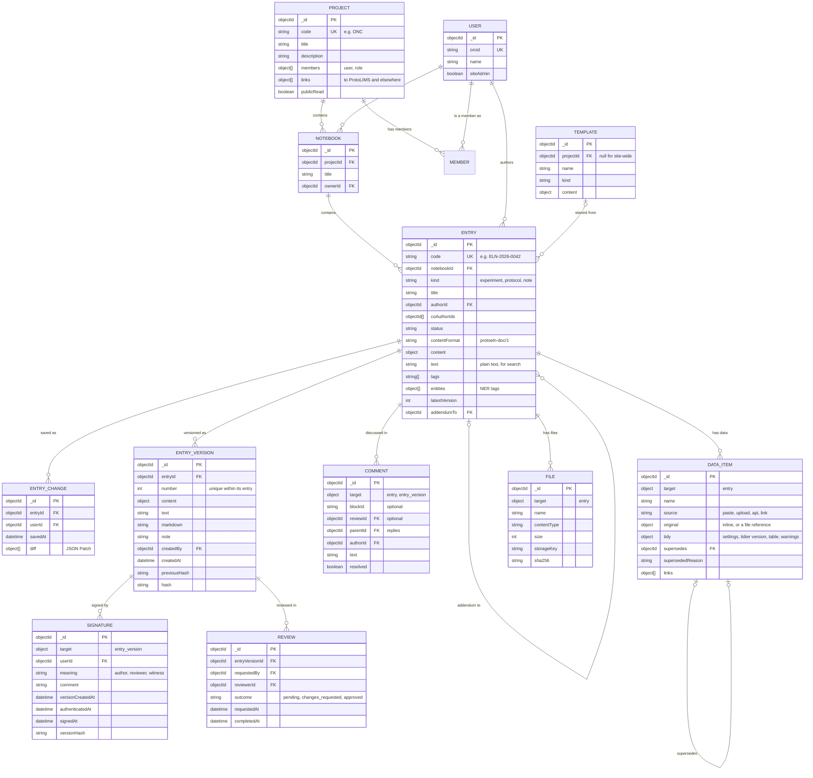

# Data model

ProtoELN is an electronic lab notebook (ELN). It follows standard ELN practice: entries belong
to their authors, every change is recorded, versions are immutable, and signed entries are
locked. Data is never changed invisibly: originals are kept exactly as received.

ProtoELN stores its records in MongoDB through Mongoose, kept in one layer of the API so that
another database could back a different instance. Images and other large files are stored in an
S3-compatible object store; the database holds only their metadata.

## Organisation

| ProtoELN | ProtoLIMS equivalent | Holds |
| --- | --- | --- |
| Project | Project | Notebooks; members and their roles |
| Notebook | Study | Entries; has an owner (usually the scientist whose notebook it is) |
| Entry | — | One experiment, protocol or note, with a readable code such as `ELN-2026-0042`, numbered from 1 each year |

Projects in ProtoELN and ProtoLIMS can be linked to each other (see [Links](#links)).

## Collections

Collection names are snake_case plurals, like ProtoLIMS's tables. A collection is prefixed with
its parent when its records only make sense inside that parent (`entry_versions`,
`entry_changes`). A collection has a plain name when its records could attach to several kinds
of thing (`signatures`, `comments`, `data_items`, `files`); those records say what they are
attached to with `target: { type, id }`.

| Collection | Holds |
| --- | --- |
| `users` | People, identified by their ORCID iD |
| `projects` | Projects, their members and roles, and links to other systems |
| `notebooks` | Notebooks within a project |
| `entries` | The current state of each entry, including its saved draft |
| `entry_changes` | One record per save: who, when, and what changed (a diff) |
| `entry_versions` | Immutable, numbered, hash-chained snapshots of an entry |
| `signatures` | Author, reviewer and witness signatures on a version |
| `reviews` | Review requests and their outcomes |
| `comments` | Comments on an entry, a version or a block within it |
| `data_items` | Structured data: pasted tables, CSV and JSON files, API results, links to large raw data |
| `files` | Images, PDFs and other files that are stored and shown, but not tidied |
| `templates` | Starting points for new entries |
| `counters` | Internal: the next number in each sequence, such as entry codes (`ELN-2026-0042`) |

In the interface, data items are called **data** ("Add data").

## Diagram



## Entry content

An entry's content is stored in ProtoELN's own small, documented block format, tagged with its
version (`protoeln-doc/1`). It uses the ProseMirror document structure that the Tiptap editor
works with, but only a deliberately limited set of blocks. The format's name is stored with the
content (`contentFormat`), so a later format can be introduced alongside it:

- paragraph, heading, bulleted and numbered list, quote, code, table
- **data block**: shows a data item
- **file block**: shows an image or links to a file
- **protocol step**: a step that can be ticked off, with who ticked it and when
- **materials**: reagents and consumables used, with lot numbers
- **link**: a link to a record elsewhere, such as a ProtoLIMS sample

Limiting the format means a different editor could replace Tiptap with one converter. Each
version also stores plain-text and Markdown copies, so content stays readable without any
editor. Export to the ELN Consortium's `.eln` format (a zipped RO-Crate) is planned for
exchange with other ELNs.

## Saving, versions and signing

Three separate actions:

| Action | When | What is stored |
| --- | --- | --- |
| **Save** | Automatically while editing, or with Ctrl+S | The draft on the entry, plus an `entry_changes` record: who, when and a diff |
| **Create version** | Deliberately, when the author chooses | A full, immutable, numbered snapshot in `entry_versions`, with an optional note |
| **Sign** | Deliberately, on a specific version | A `signatures` record; the author's signature locks the entry |

Drafts are saved to the server, so closing the browser loses nothing. The `entry_changes`
records make the audit trail complete without storing a full copy on every save: each records
the change as a JSON Patch (RFC 6902), from which any earlier draft can be rebuilt. A save is
refused if someone else has saved the entry since the editor loaded it, rather than silently
overwriting their work.

Writes that belong together (a draft and its change record; a version and the entry's version
number) are made in a single database transaction, so either both are saved or neither is.

Each version stores a hash (SHA-256) of its content together with the previous version's hash,
so any later change to a stored version would be detectable. ProtoELN can recalculate the hashes
to check an entry's history, reporting any version that has been changed, removed or unchained.

## Signatures

A signature is a recorded statement, made by an identified person, about one specific version.

| Meaning | Statement |
| --- | --- |
| Author | I performed this work and it is recorded accurately and completely. |
| Reviewer | I have reviewed this entry and approve it. |
| Witness | I have read and understood this entry. |

To sign, a person sees the exact version and its creation time, chooses the meaning, and
confirms their identity with ORCID. Re-authentication is only asked for when signing, and only
if their last ORCID sign-in was more than a few minutes ago (ORCID's OpenID Connect `max_age`);
it does not sign them out of ProtoELN, and browsing never asks for it.

Each signature records, from the server's clock in UTC: when the version was created, when the
signer last authenticated, and when they signed.

The witness should be a different person from the author, and ideally not involved in the work.

**Signatures in ProtoELN are a prototype of standard ELN practice. They carry no legal force and
are not qualified electronic signatures.** The demo at protoeln.org is read-only.

## Status and review

```text
draft → in review → changes requested → approved → signed → witnessed
```

1. The author creates a version and requests a review, choosing a reviewer.
2. The reviewer comments on the whole entry or on particular blocks, then completes the review:
   **request changes** or **approve**.
3. After changes are requested, the author replies, edits, creates a new version and requests a
   re-review.
4. The author signs an approved version, which locks the entry.
5. A witness countersigns. The approving reviewer can do this in one step.

Review is optional: an author can sign a version without one.

People see what needs their attention (reviews requested, reviews completed, entries awaiting a
witness) on their home page.

## Corrections

| Situation | What happens |
| --- | --- |
| Content or data not yet in any version | Can be edited or deleted |
| Data in a version | Superseded by a corrected data item, with a reason; the old one is kept and marked superseded |
| A signed entry | Corrected by an **addendum**: a new entry linked to the signed one |
| Content that must be removed (personal data, legal request) | **Redacted** by a site admin: the content is removed, and a visible record of who, when and why is kept; the version history stays intact |

Nothing in a version is deleted through the app.

## Data items

A data item is one piece of structured data attached to an entry: cells pasted from a
spreadsheet, an instrument's CSV or JSON export, a result posted by a script or pipeline, or a
link to large raw data stored elsewhere, with a summary.

Each data item keeps:

- **The original, exactly as received.** Originals up to the instance's inline limit (1 MB by
  default, configurable) are stored in the database; larger ones go to the object store as a file.
- **Where it came from:** who added it, when, how (paste, upload, API, link) and from which
  instrument or script, if known.
- **The tidied table view**, where the data is tabular: column names and types, together with
  the settings and tidier version that produced it, and any warnings.

Tidying never changes the original, and is re-runnable. People can override any guess (which
row holds the column names, the separator, rows to skip, each column's type) and tidy again. If
data can't be tidied, it is still kept and shown as it is, with an explanation; using the
original as it is is always an option.

## Files

Images, PDFs and other files that ProtoELN stores and shows, but doesn't tidy. The bytes are in
an S3-compatible object store (Cloudflare R2, Amazon S3, Google Cloud Storage, or a local folder,
chosen by configuration); the database holds the name, type, size, storage key and SHA-256
checksum.

Checksums are checked against the object store's own metadata without downloading the file, and
in full whenever a file is downloaded.

## Links

A link records that something in ProtoELN is related to a record elsewhere:

```json
{
  "system": "protolims",
  "kind": "project",
  "id": "…",
  "url": "https://protolims.org/projects/…",
  "label": "TCGA-BRCA",
  "addedBy": "…",
  "addedAt": "…"
}
```

Links can be held by projects, notebooks, entries and data items, and are many-to-many: a
ProtoELN project can link to several ProtoLIMS projects, and the reverse.

Planned integration with ProtoLIMS, in stages:

1. Project-to-project links.
2. Entries and data items linking to ProtoLIMS samples, assays and data files, and, once
   ProtoLIMS has inventory, to reagent lots used in an entry's materials.
3. ProtoLIMS showing the notebook entries that mention its records, through ProtoELN's API.

## Roles

| Role | Can |
| --- | --- |
| Site admin | Everything, including redaction |
| Project admin | Manage the project, its members and its notebooks |
| Project member | Create notebooks and entries, edit their own entries, comment, review and sign |
| Project viewer | Read |

Entries belong to their authors: only the author and any co-authors they add can edit an entry.

## Search

Atlas Search allows three indexes on the free M0 cluster. ProtoELN plans to use one for entries
(title, plain text, tags and entities), one for data items, and one vector index for the
retrieval-augmented generation stretch goal.

## Instance settings

| Setting | Default | Meaning |
| --- | --- | --- |
| Inline data limit | 1 MB | Largest original stored directly in the database |
| Re-authentication window | 5 minutes | How recent an ORCID sign-in must be to sign without signing in again |
